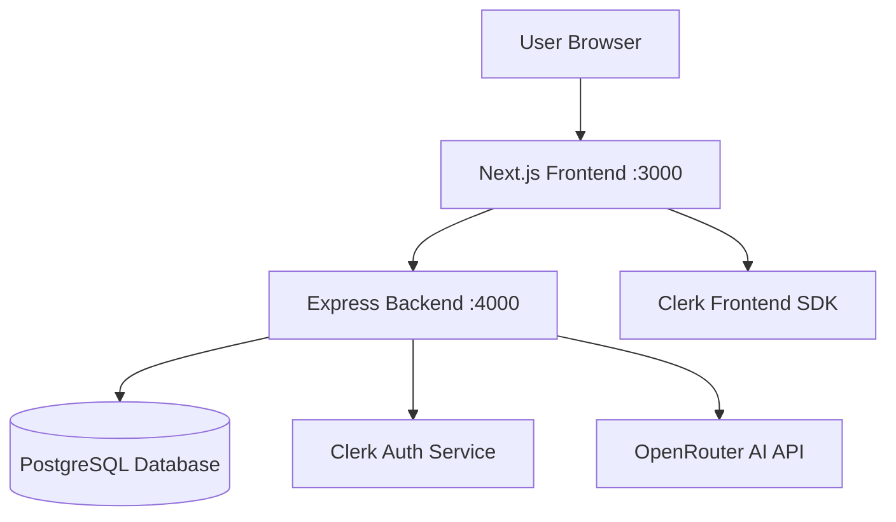
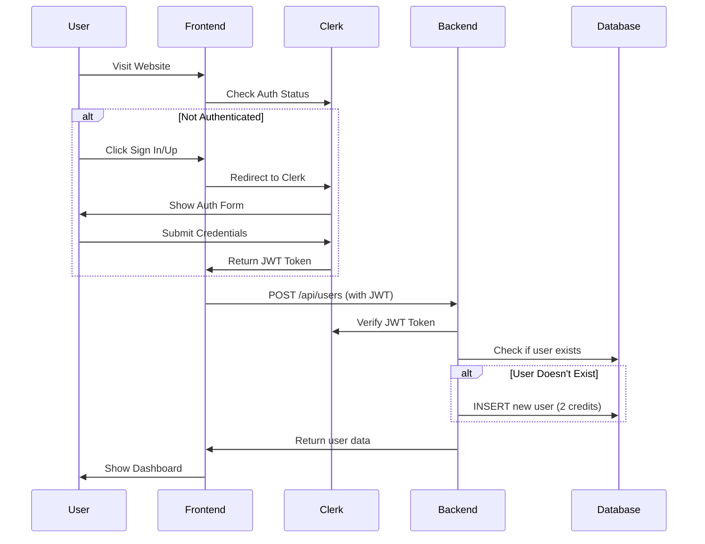
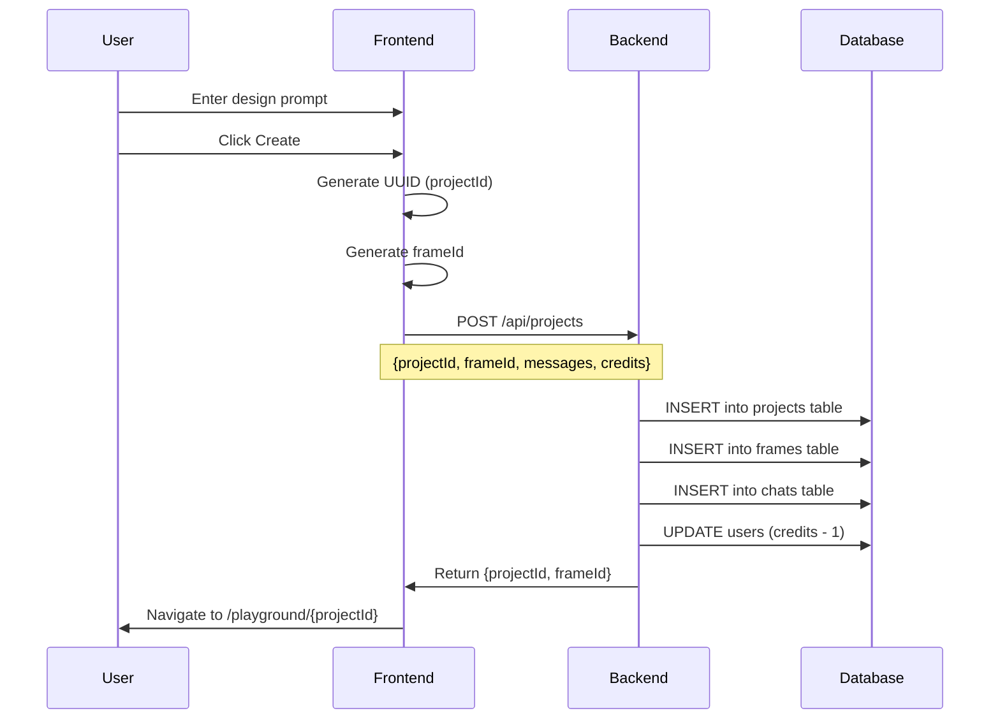
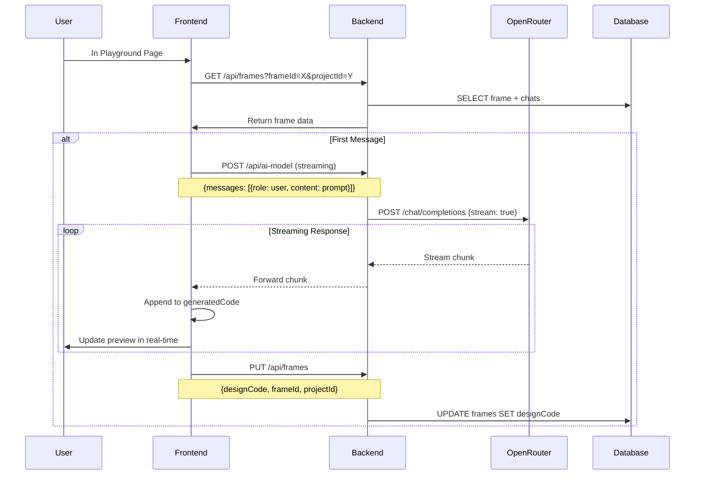
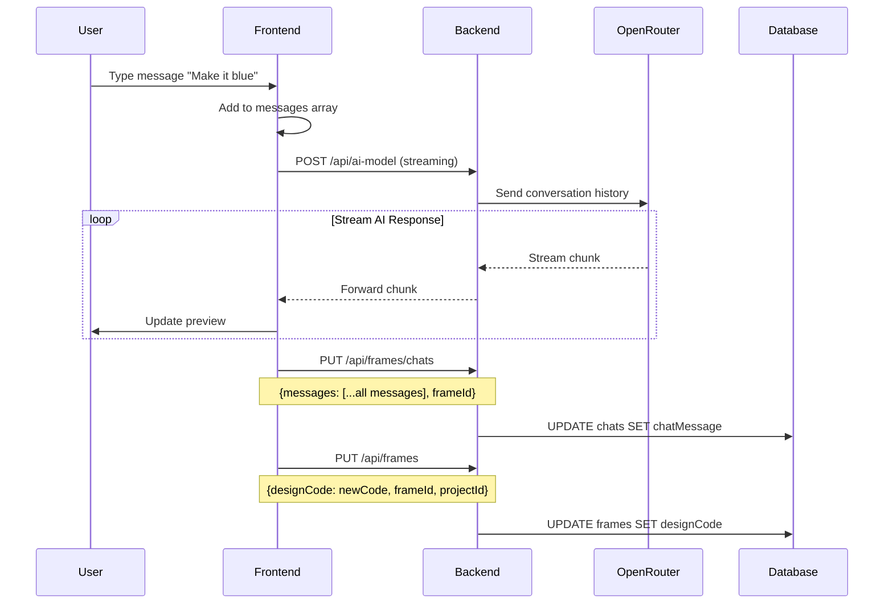
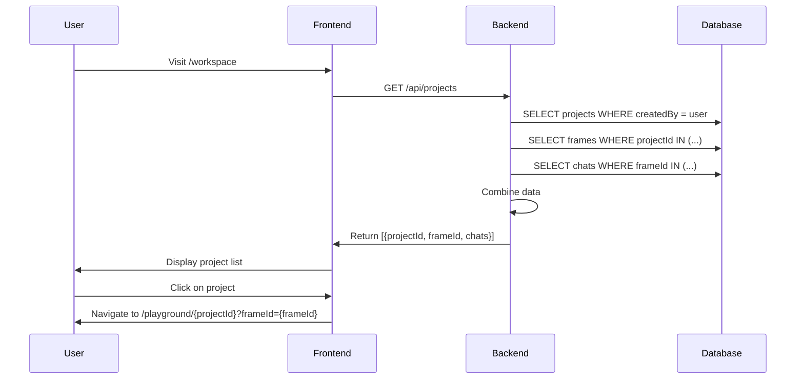
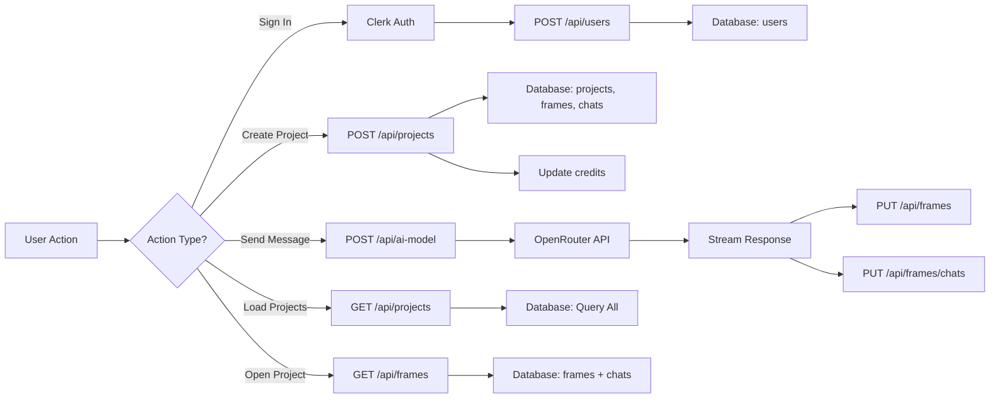
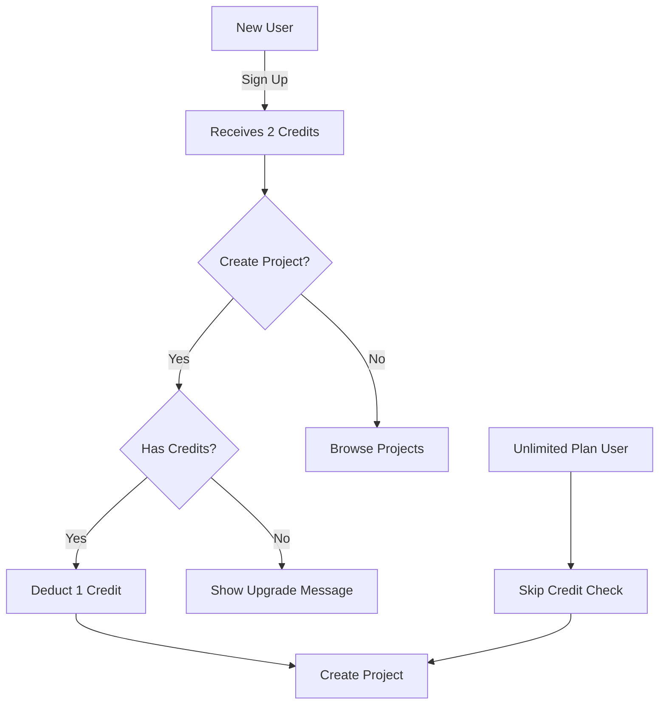
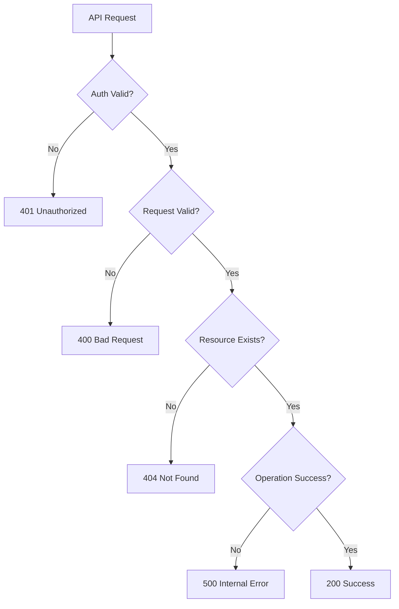

# Webyrix - Complete System Workflow

## System Architecture Overview

## Complete User Journey Flow

### 1. User Authentication Flow

### 2. Project Creation Flow

### 3. AI Design Generation Flow

### 4. Chat & Iteration Flow

### 5. Project List & Navigation Flow

## API Endpoint Workflow Details

### POST /api/users
**When**: On every app load (after Clerk auth)
**Purpose**: Create or retrieve user account
**Flow**:
1. Frontend gets JWT from Clerk
2. Backend verifies JWT with Clerk
3. Backend fetches user details from Clerk API
4. Backend checks if user exists in database
5. If not, creates user with 2 credits
6. Returns user data to frontend

### POST /api/projects
**When**: User creates new project
**Purpose**: Initialize project, frame, and chat
**Flow**:
1. Frontend generates projectId (UUID) and frameId
2. Backend creates project record
3. Backend creates frame record
4. Backend creates chat record with initial message
5. Backend deducts 1 credit from user (if not unlimited)
6. Returns confirmation

### GET /api/projects
**When**: User visits workspace/sidebar
**Purpose**: List all user's projects
**Flow**:
1. Backend queries projects by user email
2. For each project, fetch associated frames
3. For each frame, fetch associated chats
4. Combine and return nested data structure

### GET /api/frames
**When**: User opens a project in playground
**Purpose**: Load frame design and chat history
**Flow**:
1. Backend queries frame by frameId and projectId
2. Backend queries all chats for that frameId
3. Flattens chat messages into single array
4. Returns frame with chatMessages array

### PUT /api/frames
**When**: User saves design or AI generates new code
**Purpose**: Update frame's design code
**Flow**:
1. Frontend sends HTML code
2. Backend updates frame record
3. Returns success confirmation

### PUT /api/frames/chats
**When**: User sends message or AI responds
**Purpose**: Update conversation history
**Flow**:
1. Frontend sends entire messages array
2. Backend updates chat record
3. Returns success confirmation

### POST /api/ai-model
**When**: User sends message to AI
**Purpose**: Generate AI response (streaming)
**Flow**:
1. Frontend sends messages array
2. Backend forwards to OpenRouter API
3. Backend streams response chunks back
4. Frontend accumulates and displays in real-time

## Data Flow Diagram

## Component Interaction Map

### Frontend Components
- **Hero.tsx**: Project creation → POST /api/projects
- **AppSidebar.tsx**: Project list → GET /api/projects
- **Provider.tsx**: User initialization → POST /api/users
- **page.tsx (playground)**: 
  - Load frame → GET /api/frames
  - Send messages → POST /api/ai-model
  - Save chats → PUT /api/frames/chats
  - Save design → PUT /api/frames
- **WebsiteDesign.tsx**: Save design → PUT /api/frames

### Backend Routes
- **users.ts**: User management
- **projects.ts**: Project CRUD + listing
- **frames.ts**: Frame operations + chat updates
- **ai.ts**: AI streaming proxy

## Credit System Flow

## Error Handling Flow

## Complete Request/Response Cycle

**Example: Creating and Generating a Design**

1. **User Action**: Enter "Create a landing page" → Click Create
2. **Frontend**: Generate IDs, call POST /api/projects
3. **Backend**: Create records, deduct credit
4. **Frontend**: Navigate to playground
5. **Frontend**: Call GET /api/frames (load data)
6. **Frontend**: Detect first message, call POST /api/ai-model
7. **Backend**: Stream from OpenRouter
8. **Frontend**: Display streaming code in iframe
9. **Frontend**: Call PUT /api/frames (save code)
10. **Frontend**: Call PUT /api/frames/chats (save conversation)
11. **User**: Sees live preview of generated design

This workflow repeats for each user interaction!
